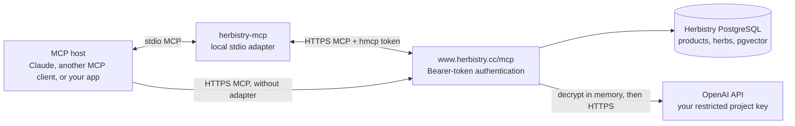

# Herbistry MCP Client Demo

A Python stdio adapter and example clients for the **Herbistry Model Context Protocol (MCP)** service. Search supplement products, browse herb profiles, inspect product labels, and ask questions grounded in Herbistry's scientific literature database.

> **Invitation-only closed beta, bring your own key (BYO key).** There is no self-service MCP signup. Access is arranged individually with the Herbistry operator. The intended beta arrangement is that you provide a **restricted OpenAI project API key** for embeddings and generation, and are responsible for the usage charges on your own OpenAI account. You then receive a separate `hmcp_...` Herbistry token for MCP authentication.

The public endpoint is:

```text
https://www.herbistry.cc/mcp
```

**Herbistry provides research information, not medical advice.** Always check the cited sources and consult a qualified healthcare professional before making health decisions.

## How it works

This repository contains two ways to use the service:

1. **A stdio adapter** for MCP hosts that launch local subprocesses. It forwards tool calls to Herbistry's remote Streamable HTTP MCP endpoint.
2. **Example applications** that use the official MCP Python client directly, without the stdio adapter.



Your **Herbistry token** authenticates the MCP connection. Your **OpenAI key** stays on the server and is never required in the local client configuration.

## Available tools

| Tool | What it does | Main arguments |
|---|---|---|
| `search_products` | Searches product names and botanical ingredients | `query`, optional `limit` |
| `get_product` | Returns a product, ingredients, label statements, and prices | `dsld_id` |
| `search_herbs` | Searches common and scientific herb names | `query`, optional `limit` |
| `get_herb` | Returns an herb profile and linked products | exact `herb_name` |
| `ask_herbal_rag` | Answers with cited scientific context, related herbs/products, and usage metrics | `question` |

Catalog tools do not modify the Herbistry catalog. Queries and token/model usage are logged for quotas, security, and administration.

## Requirements

- Python 3.10 or newer
- An invitation and a valid `hmcp_...` token
- A restricted OpenAI project key arranged with the operator for BYO-key RAG usage
- An MCP host only if you want to use the stdio adapter; the example apps need no additional host

## 1. Install

```bash
git clone git@github.com:deneskelenyi/herbistry-mcp-client-demo.git
cd herbistry-mcp-client-demo
python3 -m venv .venv
source .venv/bin/activate
python -m pip install --upgrade pip
pip install .
```

For HTTPS cloning instead:

```bash
git clone https://github.com/deneskelenyi/herbistry-mcp-client-demo.git
```

## 2. Complete the private onboarding

1. Request an invitation by contacting **contact@herbistry.cc**.
2. Follow the operator's registration and private onboarding instructions.
3. Provide a **restricted OpenAI project key** through the agreed private process. Do not post it in an issue, commit it, or send it through an insecure channel.
4. Set a low spending limit on that OpenAI project. Use a separate key so you can revoke it independently.
5. Receive and securely store your `hmcp_...` Herbistry token. It is displayed only when issued.

The operator stores the OpenAI credential encrypted with Fernet. It is decrypted in memory only when needed for a request and is then sent directly to OpenAI over HTTPS. Your MCP client receives neither the OpenAI key nor the encryption key.

## 3. Run the example app

Set the token in your environment:

```bash
export HERBISTRY_MCP_TOKEN='hmcp_...'
```

The endpoint defaults to `https://www.herbistry.cc/mcp`. To set it explicitly:

```bash
export HERBISTRY_MCP_URL='https://www.herbistry.cc/mcp'
```

Run a turmeric research query:

```bash
python examples/herb_research.py \
  --herb turmeric \
  --question 'What does the evidence say about turmeric and inflammation?'
```

The application initializes an MCP session, lists the available tools, calls `search_herbs`, and then calls `ask_herbal_rag`.

Abridged output looks like:

```text
Available tools: search_products, get_product, search_herbs, get_herb, ask_herbal_rag

Herb search:
{
  "query": "turmeric",
  "results": [
    {
      "common_name": "Turmeric / Curcumin",
      "scientific_name": "Curcuma longa",
      "url": "https://www.herbistry.cc/herb/Turmeric%20%2F%20Curcumin"
    }
  ]
}

Cited RAG response:
{
  "answer": "...",
  "sources": [{ "number": 1, "source": "...", "preview": "..." }],
  "related_herbs": ["..."],
  "provider": "byo_openai",
  "usage": { "input_tokens": 0, "output_tokens": 0 },
  "remaining": 99
}
```

Token counts and quota values above are illustrative; real values appear in the actual response.

### Product-label example

Search for a product and retrieve the first matching product's full MCP record:

```bash
python examples/product_label.py --query 'turmeric'
```

This demonstrates `search_products` followed by `get_product`. The result can include serving size, ingredient amounts, daily values, other ingredients, label statements, retailer prices, images, and Herbistry URLs. Missing source data is returned as empty or null values rather than invented.

### Use the stdio adapter with an MCP host

Find the installed executable:

```bash
which herbistry-mcp
```

Add the adapter to your MCP host's configuration, using the **absolute** executable path:

```json
{
  "mcpServers": {
    "herbistry": {
      "command": "/absolute/path/to/herbistry-mcp-client-demo/.venv/bin/herbistry-mcp",
      "env": {
        "HERBISTRY_MCP_TOKEN": "hmcp_...",
        "HERBISTRY_MCP_URL": "https://www.herbistry.cc/mcp"
      }
    }
  }
}
```

Restart the MCP host after changing its configuration. The adapter speaks MCP over stdio locally and Streamable HTTP with bearer authentication remotely. Do not run the adapter as an interactive terminal program and expect a prompt; it is intended to be launched by an MCP host.

For local development against a separately running Herbistry server, `HERBISTRY_MCP_URL=http://localhost:8889/mcp` is also accepted. Remote non-localhost URLs must use HTTPS.

## RAG responses

`ask_herbal_rag` uses your OpenAI project key for query embeddings and answer generation on the server. The default generation model is configured by the service, currently `gpt-4o-mini`; embeddings use `text-embedding-3-small`.

Responses include:

- an answer grounded in the retrieved context;
- numbered source records and previews;
- related herb and product links when matches are found;
- the provider and model information returned by the service;
- input, output, and embedding token usage when supplied by the provider;
- an estimated BYO OpenAI cost and remaining rolling-24-hour quota.

Cost values are configurable estimates, not an OpenAI invoice. Treat the answer as a starting point for reading the sources, not as proof of clinical efficacy or safety.

## Troubleshooting

### `401` or `Missing, invalid, or revoked MCP bearer token`

Check `HERBISTRY_MCP_TOKEN`, including the `hmcp_` prefix. Ask the operator whether the token was revoked. Do not confuse the Herbistry token with your OpenAI key.

### `No OpenAI key is stored for this user`

Your token is configured for BYO OpenAI, but onboarding has not stored a usable credential. Contact the operator. Never place the OpenAI key in `HERBISTRY_MCP_TOKEN`.

### `Daily MCP ... limit reached`

The token has reached its rolling-24-hour read or RAG allowance. Wait for older calls to age out or ask the operator to review the quota.

### MCP host starts but no tools appear

Confirm that `command` is an absolute path to the virtual environment's `herbistry-mcp` executable, restart the host, and inspect its MCP logs. You can test the remote connection independently with `examples/herb_research.py`.

### Provider or embedding errors

Check the OpenAI project's permissions, model access, balance, and spending limits. The Herbistry token can remain valid even when the associated OpenAI project rejects a request.

## Security and privacy

- Keep both credentials secret and use separate, restricted, revocable OpenAI project keys.
- Never commit tokens, keys, MCP host configuration containing secrets, or generated output containing private queries.
- The service stores only a hash of the Herbistry bearer token, not its plaintext value.
- MCP queries, answers, timestamps, quotas, and usage metrics may be logged for operations and abuse prevention.
- Use the source links and your own judgment before relying on generated summaries.

## Development

```bash
python -m pip install -e .
python -m compileall -q src examples
```

The stdio adapter forwards the five remote tools without maintaining a local catalog or embedding database. The example applications use `mcp.client.streamable_http` directly.

## License

MIT. See [LICENSE](LICENSE).
